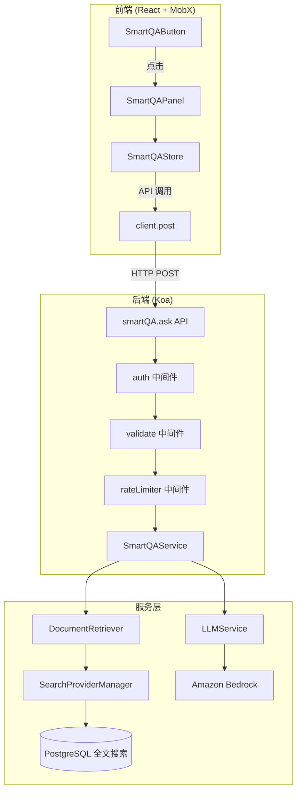
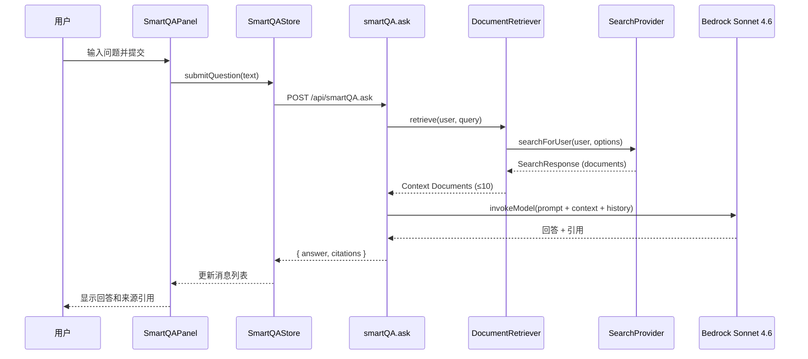

# 技术设计文档：智能问答（Smart QA）

## 概述

智能问答（Smart QA）功能为 Outline 知识库平台添加基于 RAG（检索增强生成）架构的自然语言问答能力。系统通过复用现有的文档检索基础设施获取用户有权访问的文档内容，然后调用 Amazon Bedrock Sonnet 4.6 大语言模型生成基于事实的回答，并提供可点击的来源引用链接。

本设计遵循 Outline 现有的技术栈和架构模式：
- **前端**：React + MobX + styled-components + TypeScript
- **后端**：Node.js/Koa + PostgreSQL + Zod 验证
- **API 模式**：POST 路由 + auth 中间件 + validate 中间件 + rateLimiter 中间件

### 设计目标

1. **无缝集成**：与现有 UI/UX 风格保持一致，复用 Footer、NudeButton、Tooltip 等组件模式
2. **安全性**：严格遵循用户权限模型，确保文档检索仅限于用户授权范围
3. **可扩展性**：清晰的模块分层，便于未来支持流式响应或切换 LLM 提供商
4. **性能**：合理的超时控制、结果缓存和请求限流

## 架构

### 整体架构图



### 请求流程



## 组件和接口

### 前端组件

#### 1. SmartQAButton

**位置**：`app/scenes/Document/components/SmartQAButton.tsx`

**职责**：在 Footer 区域提供智能问答入口按钮。

**设计模式**：完全复用 `KeyboardShortcutsButton` 的模式 — `observer` HOC、`NudeButton`、`Tooltip`、`useEditingFocus` hook、`styled-components-breakpoint`。

```typescript
interface SmartQAButtonProps {}

// 使用 observer 包装以响应 MobX 状态变化
// 内部调用 useStores() 获取 smartQA store
// 通过 Tooltip 提供悬停提示
// 通过 NudeButton 实现图标按钮
// 通过 breakpoint("tablet") 控制响应式显示
// 使用 useEditingFocus() 控制编辑焦点时的透明度
```

**图标**：使用 `outline-icons` 包中适合的图标（如 `QuestionMarkIcon` 或自定义 AI 图标）。

#### 2. SmartQAPanel

**位置**：`app/scenes/Document/components/SmartQAPanel.tsx`

**职责**：浮动问答交互面板，包含消息展示区和输入区。

```typescript
interface SmartQAPanelProps {
  onClose: () => void;
}

// 子组件拆分：
// - SmartQAPanelHeader: 标题栏 + 新建对话按钮 + 关闭按钮
// - SmartQAMessageList: 消息展示区域（虚拟滚动）
// - SmartQAMessageItem: 单条消息（区分用户/系统）
// - SmartQACitationList: 来源引用列表
// - SmartQAInput: 输入框 + 发送按钮
```

**面板样式**：
- `position: fixed`，右下角定位
- 宽度：`min(30vw, max-width)` 且 `min-width: 320px`
- 高度：`min(60vh, max-height)` 且 `min-height: 400px`
- `z-index` 确保浮于 Footer 之上
- 圆角 + 阴影 + 主题适配

#### 3. SmartQAInput

**位置**：`app/scenes/Document/components/SmartQAInput.tsx`

**职责**：问题输入框组件。

```typescript
interface SmartQAInputProps {
  onSubmit: (text: string) => void;
  disabled: boolean;
  maxLength: number; // 2000
  preservedValue?: string; // 错误时保留的输入
}
```

**行为**：
- Enter 键提交（Shift+Enter 换行）
- 空白内容时发送按钮禁用
- 加载状态时整体禁用
- 字符计数提示（接近上限时）

#### 4. SmartQAMessageItem

**位置**：`app/scenes/Document/components/SmartQAMessageItem.tsx`

**职责**：渲染单条消息，支持 Markdown 渲染和来源引用展示。

```typescript
interface SmartQAMessageItemProps {
  message: QAMessage;
  onCitationClick: (citation: Citation) => void;
}
```

**Markdown 渲染**：复用 Outline 现有的 Markdown 渲染组件或使用 `react-markdown` 配合 `remark-gfm` 插件。

### 前端状态管理

#### SmartQAStore

**位置**：`app/stores/SmartQAStore.ts`

**职责**：管理智能问答的全部前端状态，包括面板可见性、对话历史、加载状态和错误状态。

```typescript
class SmartQAStore {
  // Observable 状态
  @observable isPanelOpen: boolean = false;
  @observable messages: QAMessage[] = [];
  @observable isLoading: boolean = false;
  @observable error: QAError | null = null;
  @observable retryCount: number = 0;
  @observable preservedInput: string = "";
  @observable isRateLimited: boolean = false;

  // 常量
  readonly MAX_ROUNDS = 50;
  readonly MAX_MESSAGES = 100; // 50 rounds × 2
  readonly MAX_CONTEXT_ROUNDS = 20;
  readonly MAX_RETRY = 3;
  readonly RATE_LIMIT_COOLDOWN = 60000; // 60s

  // Actions
  @action openPanel(): void;
  @action closePanel(): void;
  @action togglePanel(): void;
  @action async submitQuestion(text: string): Promise<void>;
  @action newConversation(): void;
  @action retry(): void;

  // Computed
  @computed get canSubmit(): boolean;
  @computed get canRetry(): boolean;
  @computed get recentHistory(): QAMessage[]; // 最近 20 轮
}
```

**注册方式**：在 `RootStore` 中注册为非模型 Store：
```typescript
this.registerStore(SmartQAStore, "smartQA");
```

### 后端接口

#### API 端点：smartQA.ask

**位置**：`server/routes/api/smartQA/smartQA.ts`

**HTTP 方法**：POST

**路由名称**：`smartQA.ask`

**中间件链**：
```typescript
router.post(
  "smartQA.ask",
  auth(),
  rateLimiter(RateLimiterStrategy.TwentyFivePerMinute),
  validate(SmartQAAskSchema),
  async (ctx: APIContext<SmartQAAskReq>) => { ... }
);
```

**请求 Schema**（Zod 验证）：

```typescript
// server/routes/api/smartQA/schema.ts
export const SmartQAAskSchema = BaseSchema.extend({
  body: z.object({
    /** 用户提交的问题文本 */
    question: z.string().min(1).max(2000).refine(
      (val) => val.trim().length > 0,
      { message: "Question cannot be empty or whitespace only" }
    ),
    /** 可选的对话历史标识 */
    conversationId: z.uuid().optional(),
    /** 对话历史（最近 20 轮） */
    history: z.array(z.object({
      role: z.enum(["user", "assistant"]),
      content: z.string(),
    })).max(40).optional(),
  }),
});
```

**响应结构**：

```typescript
interface SmartQAResponse {
  answer: string;         // Markdown 格式的回答
  citations: Citation[];  // 来源引用列表（最多 10 条）
  conversationId: string; // 对话标识
}

interface Citation {
  id: string;       // 文档 UUID
  title: string;    // 文档标题
  url: string;      // 文档相对路径
}
```

**错误响应**：

| 状态码 | 场景 | 错误类型 |
|--------|------|----------|
| 401 | 未认证 | AuthenticationError |
| 400 | 验证失败（空问题/超长） | ValidationError |
| 429 | 速率超限 | RateLimitExceededError |
| 408 | LLM 超时 | RequestTimeoutError |
| 500 | 内部服务错误 | InternalError |

### 后端服务层

#### DocumentRetriever

**位置**：`server/services/SmartQADocumentRetriever.ts`

**职责**：基于用户权限和问题语义检索相关文档。

```typescript
class SmartQADocumentRetriever {
  /**
   * 检索用户有权限访问的相关文档
   * 复用 SearchProviderManager.getProvider().searchForUser()
   * 
   * @param user - 当前认证用户
   * @param query - 用户问题文本
   * @returns 最多 25 篇相关文档的内容
   */
  async retrieve(user: User, query: string): Promise<RetrievedDocument[]>;
}

interface RetrievedDocument {
  id: string;
  title: string;
  url: string;
  content: string;    // 文档文本内容
  ranking: number;    // 相关性排名
}
```

**实现细节**：
- 调用 `SearchProviderManager.getProvider().searchForUser(user, { query, limit: 25, statusFilter: [] })`
- `searchForUser` 内部已经处理了用户权限过滤（Collection 成员权限 + 文档级别权限）
- 额外过滤条件：`publishedAt IS NOT NULL AND archivedAt IS NULL AND deletedAt IS NULL`
- 返回结果按相关性排序，取前 25 篇

#### LLMService

**位置**：`server/services/SmartQALLMService.ts`

**职责**：与 Amazon Bedrock 交互，生成基于上下文的回答。

```typescript
class SmartQALLMService {
  private client: BedrockRuntimeClient;
  private readonly MODEL_ID = "anthropic.claude-sonnet-4-20250514";
  private readonly MAX_CONTEXT_DOCS = 10;
  private readonly MAX_INPUT_TOKENS = 180000; // 预留输出 token
  private readonly TIMEOUT_MS = 30000;

  /**
   * 基于上下文文档和对话历史生成回答
   */
  async generateAnswer(params: {
    question: string;
    documents: RetrievedDocument[];
    history: ConversationMessage[];
  }): Promise<LLMResponse>;
}

interface LLMResponse {
  answer: string;
  citedDocumentIds: string[]; // 回答中引用的文档 ID
}
```

**实现细节**：
- 使用 `@aws-sdk/client-bedrock-runtime` 的 `InvokeModelCommand`
- 文档选择：从 25 篇检索结果中取相关性最高的前 10 篇
- Token 计算：使用简单的字符/token 估算（中文约 1.5 字符/token，英文约 4 字符/token）
- 如果 10 篇文档总 token 仍超限，按相关性从低到高逐篇移除
- 超时控制：使用 `AbortController` 配合 30 秒 `setTimeout`

**Prompt 设计**：

```
系统提示：
你是一个知识库问答助手。请基于以下文档内容回答用户问题。
规则：
1. 仅基于提供的文档内容回答，不要使用外部知识
2. 如果文档中没有相关信息，请明确告知用户
3. 在回答中引用来源文档，使用 [docId:UUID] 格式标记引用
4. 回答使用 Markdown 格式

文档上下文：
[文档1标题] (ID: uuid-1)
文档1内容...

[文档2标题] (ID: uuid-2)
文档2内容...

对话历史：
用户: 之前的问题...
助手: 之前的回答...

当前问题：
{用户问题}
```

### 注册路由

在 `server/routes/api/index.ts` 中添加：
```typescript
import smartQA from "./smartQA";
// ...
router.use("/", smartQA.routes());
```

## 数据模型

### 前端数据类型

```typescript
// shared/types/smartQA.ts

/** 单条消息 */
interface QAMessage {
  id: string;                  // 客户端生成的 UUID
  role: "user" | "assistant";  // 角色标识
  content: string;             // 消息内容（用户问题或 Markdown 回答）
  timestamp: number;           // Unix 时间戳（ms）
  citations?: Citation[];      // 仅 assistant 消息包含
  error?: QAError;             // 错误信息
}

/** 来源引用 */
interface Citation {
  id: string;    // 文档 UUID
  title: string; // 文档标题
  url: string;   // 文档相对路径（如 /doc/slug-xxx）
}

/** 错误类型 */
interface QAError {
  type: "timeout" | "rate_limit" | "retrieval_failed" | "unknown";
  message: string;
  retryable: boolean;
}
```

### 后端无持久化

本功能不引入新的数据库表。原因：
1. 对话历史仅保留在前端内存中（页面刷新即清除），满足需求 6.3 的定义
2. 文档检索复用现有的 `Document` 模型和搜索索引
3. 来源引用数据从现有文档记录中提取

如果未来需要持久化对话历史，可以添加 `Conversation` 和 `ConversationMessage` 模型。

## 正确性属性

*正确性属性是系统在所有有效执行中应保持为真的特征或行为——本质上是关于系统应该做什么的形式化陈述。属性作为人类可读规格说明和机器可验证正确性保证之间的桥梁。*

### 属性 1：空白输入拒绝

*对于任何* 仅由空白字符（空格、换行、制表符或其组合）组成的字符串，提交该字符串应被系统拒绝，消息列表不发生变化，且发送按钮保持禁用状态。

**验证需求：2.6, 7.2**

### 属性 2：消息时间排序不变量

*对于任何* 对话中的消息列表，消息始终按时间戳升序排列——即对于列表中任意相邻的两条消息 m[i] 和 m[i+1]，必有 m[i].timestamp <= m[i+1].timestamp。

**验证需求：2.4**

### 属性 3：有效输入提交追加消息

*对于任何* 非空白的有效问题字符串（长度 1-2000 且 trim 后非空），提交后消息列表长度增加 1，且最后一条消息的内容等于提交的问题文本，角色为 "user"。

**验证需求：2.5**

### 属性 4：文档检索权限过滤正确性

*对于任何* 用户及其权限范围，文档检索结果中的每一篇文档都必须满足：(a) 用户是该文档所属 Collection 的成员或拥有文档级别的独立访问权限，且 (b) 文档的 publishedAt 不为空，且 (c) 文档的 archivedAt 为空，且 (d) 文档的 deletedAt 为空。

**验证需求：3.1, 3.2, 3.3**

### 属性 5：检索结果数量上限不变量

*对于任何* 搜索查询返回的文档集合，传递给后续处理的文档数量不超过 25 篇。

**验证需求：3.4**

### 属性 6：LLM 上下文文档上限和 Token 限制

*对于任何* 检索到的文档集合，发送给 LLM 的上下文文档数量不超过 10 篇，且总上下文 Token 数不超过模型最大输入 Token 数。

**验证需求：4.5**

### 属性 7：来源引用渲染正确性（排序、去重、上限）

*对于任何* 包含引用的 LLM 响应，渲染的来源引用列表满足：(a) 引用按首次出现顺序排列，(b) 同一文档 ID 仅出现一次（去重），(c) 总数不超过 10 条。

**验证需求：5.1, 5.6**

### 属性 8：来源引用标题截断

*对于任何* 文档标题，如果标题长度超过 80 个字符，则展示的标题应在第 80 个字符处截断并以省略号（...）结尾；如果标题长度不超过 80 个字符，则完整展示。

**验证需求：5.2**

### 属性 9：对话历史有界滑动窗口

*对于任何* 对话序列，消息总轮次（一问一答为一轮）始终不超过 50 轮（100 条消息）。当达到上限时添加新消息，应自动移除最早的完整对话轮次，保持总轮次为 50。

**验证需求：6.1, 6.6**

### 属性 10：LLM 上下文对话窗口

*对于任何* 长度大于 20 轮的对话历史，发送给 LLM 的上下文历史仅包含最近 20 轮对话（40 条消息）；对于长度小于或等于 20 轮的历史，发送全部。

**验证需求：6.2**

### 属性 11：错误状态保持对话和输入

*对于任何* 在回答生成过程中发生的错误，错误发生前的对话历史消息全部保留不丢失，且用户的最后输入内容保留在输入框中可编辑。

**验证需求：7.5**

### 属性 12：API 输入验证

*对于任何* 请求中的问题文本，当长度为 0（空字符串）、仅包含空白字符（trim 后长度为 0）或超过 2000 个字符时，API 应返回验证失败错误；当长度在 1-2000 且 trim 后非空时，API 应接受该请求。

**验证需求：8.1, 8.3**

### 属性 13：来源引用响应数据完整性

*对于任何* API 响应中的 Citation 对象，必须同时包含 `id`（有效 UUID）、`title`（非空字符串）和 `url`（以 "/" 开头的相对路径）三个字段。

**验证需求：8.7**

### 属性 14：Markdown 渲染正确性

*对于任何* 包含标准 Markdown 元素（标题、列表、代码块、链接）的回答文本，渲染后的 HTML 应包含对应的语义化 HTML 元素（h1-h6、ul/ol/li、pre/code、a 标签）。

**验证需求：4.4**

## 错误处理

### 错误分类与处理策略

| 错误类型 | 触发条件 | 前端处理 | 后端处理 |
|----------|----------|----------|----------|
| 认证失败 | Token 无效/过期 | 跳转到登录页 | 返回 401 |
| 输入验证失败 | 空白/超长输入 | 禁用发送按钮 + 提示 | 返回 400 + 原因 |
| 速率限制 | 超过 25 次/分钟 | 60秒倒计时后恢复 | 返回 429 |
| 检索失败 | 搜索服务异常 | 显示错误 + 重试按钮 | 返回 500 + 日志 |
| LLM 超时 | 30秒无响应 | 显示超时 + 重试 | AbortController 中止 |
| LLM 服务不可用 | Bedrock 返回错误 | 显示错误 + 重试 | 返回 503 + 日志 |

### 重试机制

- **最大重试次数**：3 次
- **重试范围**：同一问题的同一次提交
- **重试逻辑**：前端 SmartQAStore 维护 `retryCount`，每次重试递增
- **重试耗尽**：禁用重试按钮，提示用户稍后再试
- **重置时机**：新问题提交时重置计数

### 超时处理

```typescript
// 后端超时实现
const controller = new AbortController();
const timeout = setTimeout(() => controller.abort(), 30000);

try {
  const response = await bedrockClient.send(command, {
    abortSignal: controller.signal,
  });
  clearTimeout(timeout);
  return response;
} catch (error) {
  clearTimeout(timeout);
  if (error.name === "AbortError") {
    throw new RequestTimeoutError("LLM response timeout");
  }
  throw error;
}
```

### 错误状态恢复

发生错误时的状态保护机制：
1. 移除加载指示器（`isLoading = false`）
2. 保留已有对话历史（不清空 `messages`）
3. 将用户输入恢复到输入框（`preservedInput = question`）
4. 设置错误状态（`error = { type, message, retryable }`）

## 测试策略

### 属性测试（Property-Based Testing）

**测试库**：`fast-check`（已在 Node.js 生态成熟，与 Jest 配合良好）

**配置**：每个属性测试最少运行 100 次迭代。

**属性测试覆盖**：

| 属性编号 | 测试目标 | 生成器 |
|----------|----------|--------|
| P1 | 空白输入拒绝 | 空白字符串生成器 |
| P2 | 消息时间排序 | 随机消息列表生成器 |
| P3 | 有效输入追加 | 有效问题字符串生成器 |
| P4 | 权限过滤 | 随机用户权限 + 文档集生成器 |
| P5 | 检索上限 | 随机大小文档集生成器 |
| P6 | LLM 上下文上限 | 随机文档内容生成器 |
| P7 | 引用渲染正确性 | 随机引用列表生成器 |
| P8 | 标题截断 | 随机长度字符串生成器 |
| P9 | 滑动窗口 | 随机长度对话历史生成器 |
| P10 | 上下文窗口 | 随机长度对话历史生成器 |
| P11 | 错误状态保持 | 随机对话状态 + 错误类型生成器 |
| P12 | API 输入验证 | 随机长度/内容字符串生成器 |
| P13 | 引用数据完整性 | 随机 Citation 对象生成器 |
| P14 | Markdown 渲染 | 随机 Markdown 元素组合生成器 |

**标签格式**：
```typescript
// Feature: smart-qa, Property 1: 空白输入拒绝
it.prop([fc.string()], { numRuns: 100 }, (input) => { ... });
```

### 单元测试（Example-Based）

- **SmartQAButton**：渲染、Tooltip、aria-label、编辑焦点隐藏、断点响应
- **SmartQAPanel**：打开/关闭、面板尺寸、加载状态显示
- **SmartQAStore**：submitQuestion、newConversation、retry 等 action 行为
- **API Schema**：有效请求通过验证、无效请求被拒绝

### 集成测试

- **API 端点**：完整请求链路测试（auth → validate → rateLimiter → service → response）
- **文档检索**：模拟 SearchProvider 返回结果，验证权限过滤逻辑
- **LLM 服务**：Mock Bedrock 客户端，验证 Prompt 构造和响应解析

### 边界条件测试

- LLM 30 秒超时处理
- 检索结果为空的场景
- 对话达到 50 轮上限的滑动窗口行为
- 重试 3 次耗尽的场景
- 速率限制触发和恢复
- 文档已被删除/权限撤销的引用点击

### 测试工具

- **测试框架**：Jest（项目已使用）
- **属性测试**：fast-check
- **组件测试**：React Testing Library
- **API 测试**：supertest + 项目现有测试工具
- **Mock**：jest.mock + MSW（Mock Service Worker）用于 Bedrock API
